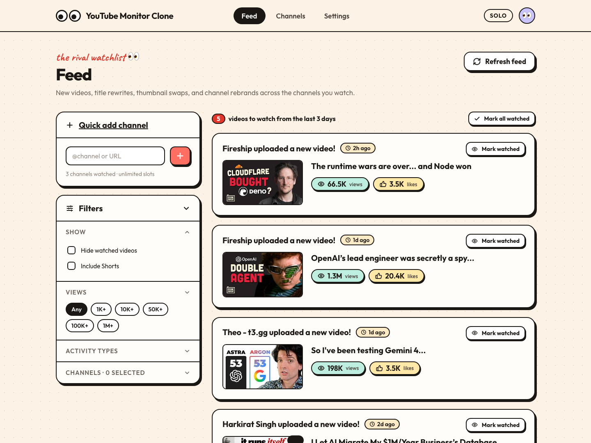

<div align="center">

# 👀 YouTube Monitor Clone

**Keep an eye on the YouTube channels you care about.**
New uploads, title rewrites, thumbnail swaps and thumbnail A/B tests in one feed, plus a to-watch list.

Unlimited channels · free to host · runs on your own Cloudflare account · no API key needed



</div>

---

## What it does

Add any channel by `@handle` or URL. The app then checks it around the clock and builds a feed of everything that changed:

| In the feed | What it means |
| --- | --- |
| 🎬 **New video** | The channel uploaded. Shows the thumbnail, title, views and likes, and a **Mark watched** button. |
| ✏️ **Title rewrite** | The creator renamed a video. Shows the old title struck through above the new one. |
| 🖼️ **Thumbnail swap** | The thumbnail was replaced. Shows the old and the new image side by side. |
| 🧪 **A/B test started** | YouTube is rotating several thumbnails on one video. Shows every variant it has seen. |
| 🏆 **A/B test finished** | The test ended. Shows the winning thumbnail and the variants that lost. |
| 📈 **Subscriber milestone** | The channel's subscriber count went up. |

You can also:

- **Mark videos as watched**, and see how many from the last *N* days you haven't watched yet. Hide the ones you've seen, or mark everything watched in one click.
- **Filter** by minimum views, activity type and channel. Shorts are hidden unless you turn them on.
- **Choose the feed window** (3, 7, 10, 30 or 60 days). History is kept for 60 days.
- **Open it on your phone.** The layout works on mobile.

## Why it's free and unlimited

It's a single [Cloudflare Worker](https://developers.cloudflare.com/workers/) plus a [D1](https://developers.cloudflare.com/d1/) (SQLite) database, both on Cloudflare's free plan. No servers, no paid APIs, no YouTube API key. It only reads public data: channel RSS feeds, public channel pages and public thumbnail images.

**There's no cap on channels.** The free plan does limit how much work each background run can do, so more channels means each one is checked a bit less often:

| Channels you watch | How often each is checked for uploads (default settings) |
| --- | --- |
| up to ~30 | every 15 minutes |
| ~60 | every 30 minutes |
| ~120 | every hour |
| more | still works, just less often; or raise the limits ([see below](#configuration)) |

Clicking **Refresh feed** checks channels right away.

## Get your own copy (about 5 minutes)

**You need:** [Node.js 18+](https://nodejs.org) and a free [Cloudflare account](https://dash.cloudflare.com/sign-up). No credit card.

```bash
git clone https://github.com/mdkaifansari04/yt-monitor-clone.git
cd yt-monitor-clone
npm install
npm run setup
```

`npm run setup` handles everything:

1. Opens your browser so you can log in to Cloudflare (first time only).
2. Creates the database in **your** account and saves its id in `wrangler.jsonc`.
3. Creates the tables.
4. Deploys the app and prints your URL, e.g. `https://yt-monitor-clone.<you>.workers.dev`.

Open the URL, paste a channel into **Quick add channel**, and you're done. Within a few minutes the background job starts filling in thumbnails and stats.

> **First Cloudflare deploy?** Wrangler may ask you to pick a `workers.dev` subdomain. Any name works.
> **Several Cloudflare accounts?** Pick one: `CLOUDFLARE_ACCOUNT_ID=<account id> npm run setup`.

You can run `npm run setup` again at any time. Later, to ship your own changes:

```bash
npm run deploy
```

## Make it yours

Everything is plain, readable code: no framework and no build step.

| Want to… | Change this |
| --- | --- |
| Rename the app / change the URL | `"name"` in [`wrangler.jsonc`](wrangler.jsonc) → becomes `https://<name>.<you>.workers.dev` |
| Change the title, logo text or taglines | [`public/index.html`](public/index.html) and the `pageHead(...)` calls in [`public/app.js`](public/app.js) |
| Change colors and fonts | The CSS variables at the top of [`public/styles.css`](public/styles.css) |
| Check more often, track more channels, keep more history | The `vars` in [`wrangler.jsonc`](wrangler.jsonc) ([table below](#configuration)) |
| Use your own domain | Cloudflare dashboard → your Worker → **Settings → Domains & Routes → Add custom domain** |
| Get comment counts and exact subscriber numbers | Add a free [YouTube Data API key](https://developers.google.com/youtube/v3/getting-started): `npx wrangler secret put YT_API_KEY` |

## Keep it private

The app has **no login**. It's built for one person, so anyone who has your URL can add or remove channels. To lock it to just you (free, no code changes):

1. Cloudflare dashboard → **Zero Trust** → **Access** → **Applications** → **Add an application** → **Self-hosted**.
2. Domain: your `*.workers.dev` URL or custom domain.
3. Add a policy: **Allow**, **Emails**, your email address.

Cloudflare will now ask for a one-time code sent to your email before showing the app.

## How it works

```
 Cloudflare cron (every 5 min)
          │
          ▼
 ┌─────────────────┐  RSS feeds           ┌──────────────┐
 │  Worker         │ ───────────────────▶ │  YouTube     │  (public data only)
 │  src/refresh.ts │  thumbnails, pages   └──────────────┘
 │                 │
 │                 │ ───────────────────▶  D1 (SQLite): channels, videos,
 └─────────────────┘                       thumbnail images, events
          ▲
          │ /api/*
 ┌─────────────────┐
 │  public/ (SPA)  │  plain HTML/CSS/JS served as static assets
 └─────────────────┘
```

- **Uploads and titles:** each channel's public RSS feed (`youtube.com/feeds/videos.xml`) lists its latest 15 videos with title, views and likes. A video we haven't seen is a new upload. A changed title is a title rewrite.
- **Thumbnails:** for 10 days after upload, the app downloads the thumbnail YouTube is serving about once an hour and fingerprints it (SHA-256). Every distinct image is stored, so old versions stay viewable after they're replaced.
  - A different image, with the old one gone → **swap**
  - Two or more images showing up in turn → **A/B test**
  - Only one image for 24 hours after a test → **finished**, and that image is the **winner**
- **Subscribers:** read from the channel's public page about every 6 hours, or from the YouTube API if you added a key.
- **Free-plan budget:** each run makes at most ~37 outbound requests, under the free plan's limit of 50. Whatever doesn't fit in one run is picked up by the next.

## Configuration

All settings are `vars` in [`wrangler.jsonc`](wrangler.jsonc). Run `npm run deploy` after changing them.

| Variable | Default | What it controls |
| --- | --- | --- |
| `CHANNEL_INTERVAL_MIN` | `15` | Minutes between upload checks for each channel |
| `THUMB_INTERVAL_MIN` | `60` | Minutes between thumbnail samples for each video |
| `THUMB_TRACK_DAYS` | `10` | Days after upload that thumbnails are watched |
| `AB_SETTLE_HOURS` | `24` | Hours a video must show only one thumbnail before its test counts as finished |
| `MAX_CHANNEL_FETCHES` | `10` | Channels checked per run |
| `MAX_THUMB_FETCHES` | `24` | Thumbnail downloads per run |
| `RETENTION_DAYS` | `60` | Days of history kept |
| `YT_API_KEY` *(secret)* | — | Optional YouTube Data API v3 key |

On the **free plan**, keep `MAX_CHANNEL_FETCHES + MAX_THUMB_FETCHES` at or below about 45. On the **paid plan** ($5/mo, 1,000 requests per run) you can raise both a lot, e.g. `100` and `200`, to check hundreds of channels every 15 minutes.

## Local development

```bash
npm install
npm run db:migrate:local   # creates a local SQLite copy of the database
npm run dev                # http://localhost:8787
```

Locally, the background job doesn't run on its own. Click **Refresh feed** (or `curl -X POST localhost:8787/api/refresh`) to run the same code.

```
src/
  index.ts      HTTP API + cron entry point
  refresh.ts    polling, title diffing, thumbnail A/B state machine
  youtube.ts    RSS / page / thumbnail / optional Data API clients
  env.ts        bindings + config helpers
public/         the whole frontend (index.html, app.js, styles.css)
migrations/     D1 schema (numbered SQL files)
scripts/        setup.mjs (one-command deploy for new users)
```

### JSON API

The frontend uses a small JSON API that you can call too, e.g. from scripts, Discord bots or spreadsheets:

| Method | Path | |
| --- | --- | --- |
| `GET` | `/api/feed?days=3&types=new_video,ab_test&channels=UC…&minViews=1000&hideWatched=1&shorts=1` | Feed events |
| `GET` | `/api/channels` | Watched channels |
| `POST` | `/api/channels` `{"input":"@handle"}` | Add a channel |
| `DELETE` | `/api/channels/:channelId` | Remove a channel |
| `POST` | `/api/videos/:videoId/watched` `{"watched":true}` | Mark a video as watched or unwatched |
| `POST` | `/api/refresh` | Run a check now |
| `GET`/`PUT` | `/api/settings` | Feed window and config |

## Troubleshooting

<details>
<summary><b>"You have reached the maximum number of D1 databases"</b></summary>

The free plan allows 10 D1 databases per account. Delete one you no longer use in the dashboard (**Storage & Databases → D1**), then run `npm run setup` again.
</details>

<details>
<summary><b>Adding a channel says "rate-limiting" or "Channel not found"</b></summary>

YouTube sometimes rate-limits requests coming from Cloudflare. Wait a minute and try again, or paste the channel's `UC…` ID (shown in the channel URL) instead of the handle. Adding a `YT_API_KEY` stops this from happening.
</details>

<details>
<summary><b>A brief <code>error code: 1042</code> right after deploying</b></summary>

For a minute or so after a deploy, Cloudflare is still rolling out the new version. The app retries once automatically. If you still see it, try again shortly.
</details>

<details>
<summary><b>No A/B tests are showing up</b></summary>

A test only shows up once the app has seen two different thumbnails on the same video, so it can take a few hours. Only videos from the last `THUMB_TRACK_DAYS` days are watched.
</details>

## Contributing

Pull requests are very welcome, whether it's a bug fix, a new feature, or a typo. See [CONTRIBUTING.md](CONTRIBUTING.md) for setup, conventions, and a list of ideas.

## Credits & disclaimer

Inspired by [Monitor YT](https://monitoryt.com). If you'd rather use a hosted product than run your own, check them out.

This project is not affiliated with YouTube, Google, or Monitor YT. It only reads information that is publicly visible to any viewer. Use it responsibly and within YouTube's Terms of Service.

## License

[MIT](LICENSE) © Md Kaif Ansari
